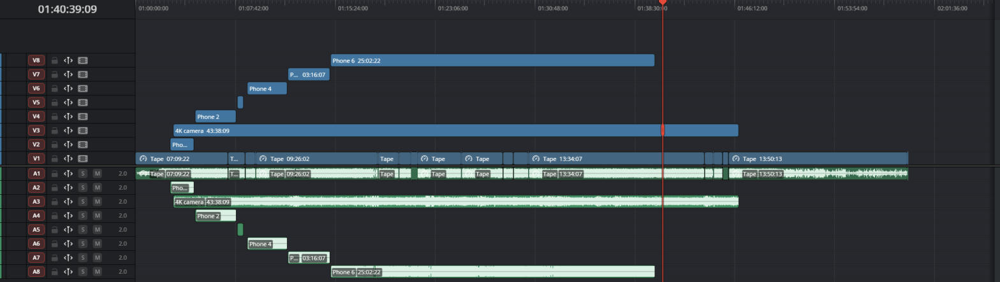
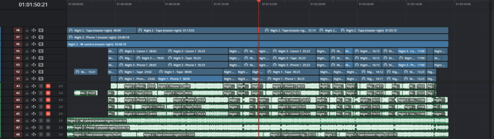
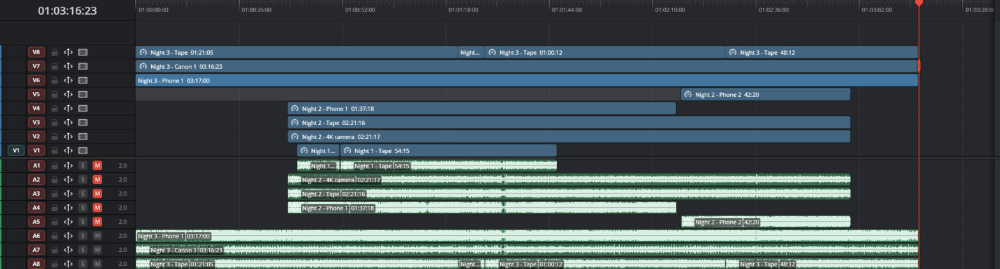

# ShowSync

Sync live-music footage by sound: concerts, live sessions and music-video takes, shot on any
mix of pro cameras, phones, Hi8 tapes and audio recorders. Built for DaVinci Resolve.

- **Exact sync, even when the audio sounds different.** A crowd phone, a boomy camera mic and the
  desk feed are lined up sample-accurately. Clock drift is measured and corrected, and so is Hi8
  tape wobble.
- **Snippets welcome.** A 15-second phone clip joins the cameras it overlaps, even if nothing
  covers the whole show.
- **No reference needed.** Songs are found and matched across clips, takes and nights by their
  harmony. Give reference song files and they become the song's name and time base.
- **Music videos with playback.** Every take is placed on song time. Copy-pasted choruses are
  handled honestly: a take that fits equally well at chorus 1 and chorus 3 is placed at one, and
  marked "also fits" at the others.
- **Results land in Resolve**:
  - one timeline per synced group, with all angles stacked and drifting angles re-cut so they
    never slip by more than half a frame;
  - one timeline per song, with every take stacked on song time and speed-matched to the longest take,
    so takes from different nights stay on the beat;
  - song markers on clips;
  - optionally, rewritten timecode (event or song time). Every change can be undone.

## What it looks like

Built from real concert footage: three nights, a Hi8 tape capture, a 4K camera, a Canon and a handful of phones.
Track and clip names were neutralised for these screenshots.

**One night, every angle.** Each camera is placed where it really was. The tape (V1) drifts about 2 ms per
second, so ShowSync re-cuts it whenever it would slip by half a frame. The phone clips land in the gaps,
each one synced by sound.



**One song, three nights.** The master night (top) runs at its own time. The other nights are re-cut at the
song's structure and speed-matched to it, so you can cut between performances on the beat. Their audio is
muted.



**Every take of one song.** All takes from all nights. The longest take runs at its own time; the others
follow the song, re-cut and speed-matched to it, with their audio muted.



## Install

Requires Python 3.10+ and FFmpeg on PATH.

```powershell
cd showsync
python -m venv .venv
.venv\Scripts\python -m pip install numpy scipy
.venv\Scripts\python resolve_plugin\install.py
```

Then in Resolve: **Workspace → Scripts → ShowSync**. See `resolve_plugin/README.md`.

## Command line

```powershell
.venv\Scripts\python -m showsync analyze D:\Show\cams D:\Show\phones --refs D:\Show\songs --report show.html
.venv\Scripts\python -m showsync conform phone_clip.mp4          # variable -> constant frame rate
.venv\Scripts\python -m showsync fix-audio showsync_result.json recorder.wav --to cam_a.mov
```

## Getting footage off a phone

Large phone clips (tens of GB) can be sent straight to your editing PC over Wi-Fi or Tailscale with
[dropdock](https://github.com/GustafMos/dropdock), a small resumable upload server that started here:

```powershell
pip install git+https://github.com/GustafMos/dropdock
dropdock
```

## How it works

Read `docs/ARCHITECTURE.md`, which explains the two levels of "together":
- **exact (event time):** the same sound;
- **musical (song time):** the same song, a different performance.

## Known limits

- A phone drowned out by crowd noise syncs exactly to other clips, but may not be recognised as a
  song on its own.
- A segue between two songs in the same key stays one segment.
- Two different songs with the same key, chords and tempo can be merged into one song.
- Picture from variable-frame-rate phone clips drifts in Resolve. Conform them first; ShowSync
  warns you which ones.

---

## Support my cats

If you want to support me and my projects, help me fund tasty anti-allergenic food for my two cats, **Carla-Mittersteig von Starhemberg** and **Rosa-Luxemburg von Starhemberg**. <3 Thank you!

**GitHub Sponsors:** <https://github.com/sponsors/GustafMos> · **Ko-fi:** <https://ko-fi.com/ripscorpy> · [FUNDING.md](FUNDING.md)

---

## License

MIT. See [LICENSE](LICENSE).
